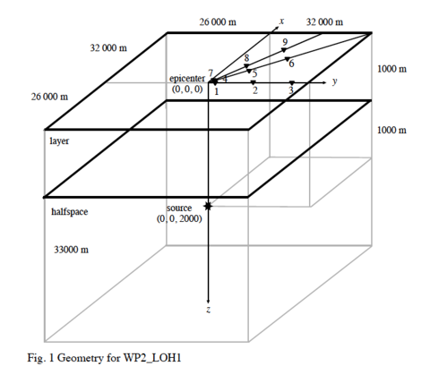
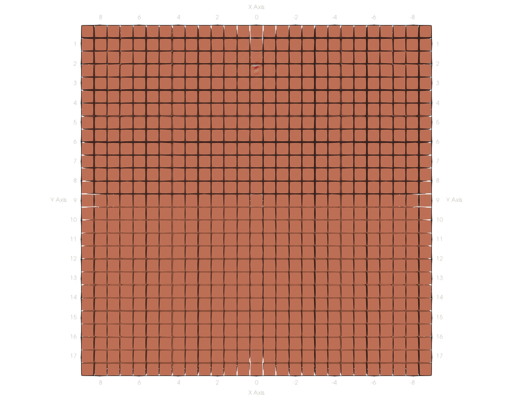
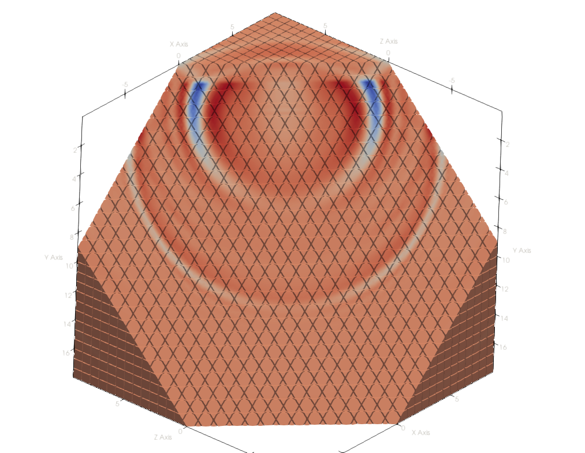
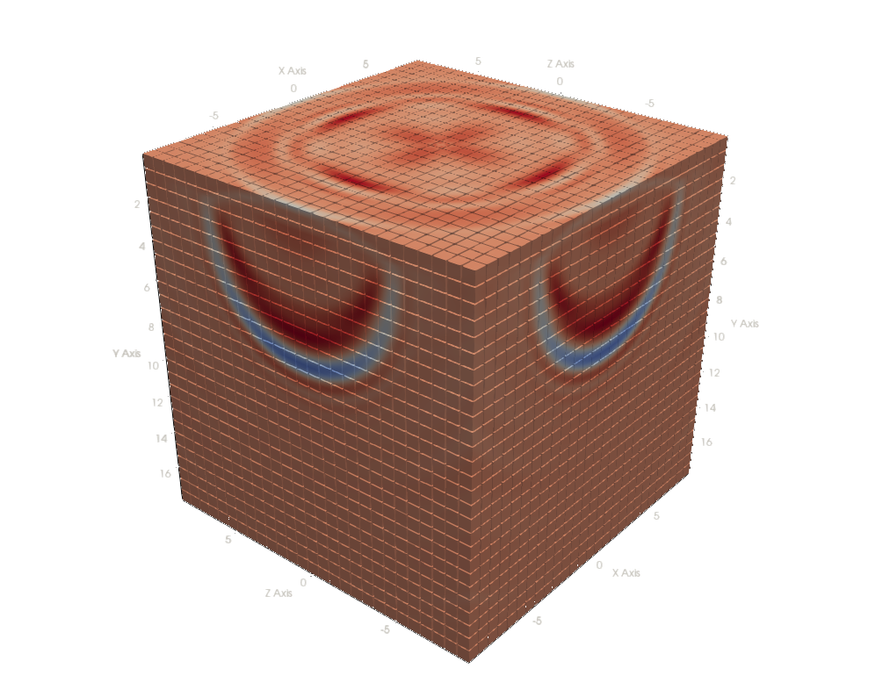
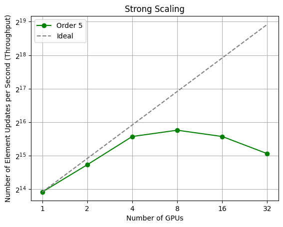
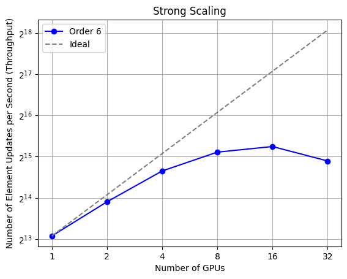
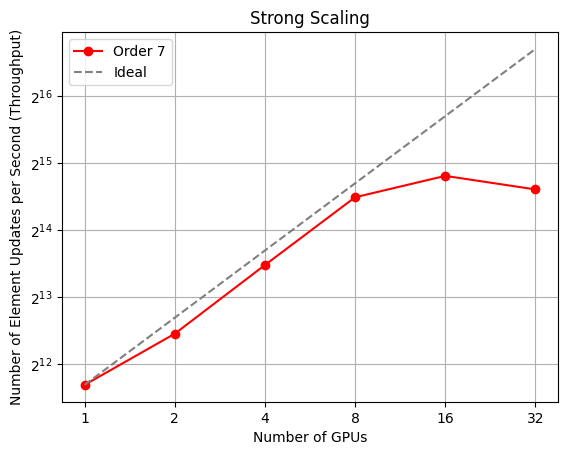

# LOH.1
Currently, the ExaSeis framework implements LOH.1 similar to as seen below.

<div align="center">

</div>

## Running LOH.1
In the following some example configurations are given:

```shell
python3 exaseis.py -s ADERDGRusanovGlobalFixedEnclave --stateless --min-levels 1 --amr-levels 0
```
Yields 27 patches.

```shell
python3 exaseis.py -s ADERDGRusanovGlobalFixedEnclave --stateless --min-levels 2 --amr-levels 0
```
Yields 729 patches.

```shell
python3 exaseis.py -s ADERDGRusanovGlobalFixedEnclave --stateless --min-levels 3 --amr-levels 0 --dg-order 5
```
Yields 19683 patches and requires ~3 GB of memory.

```shell
python3 exaseis.py -s ADERDGRusanovGlobalFixedEnclave --stateless --min-levels 3 --amr-levels 0 --dg-order 7
```
Yields 19683 patches and requires ~6 GB of memory.

```shell
python3 exaseis.py -s ADERDGRusanovGlobalFixedEnclave --stateless --min-levels 4 --amr-levels 0 --dg-order 3
```
Yields 531441 patches and requires ~25 GB of memory.

```shell
python3 exaseis.py -s ADERDGRusanovGlobalFixedEnclave --stateless --min-levels 4 --amr-levels 0 --dg-order 4
```
Yields 531441 patches and requires ~42 GB of memory.

```shell
python3 exaseis.py -s ADERDGRusanovGlobalFixedEnclave --stateless --min-levels 4 --amr-levels 0 --dg-order 5
```
Yields 531441 patches and requires ~62 GB of memory.

```shell
python3 exaseis.py -s ADERDGRusanovGlobalFixedEnclave --stateless --min-levels 5 --amr-levels 0 --dg-order 3
```
Yields 14348907 patches and requires >>250 GB of memory.

When using the `SpreadOutOnceGridStagnates` the grid construction can take hours for larger meshes. However, the load is very well balanced after the grid is constructed.

## Running LOH.1 on GPUs
To run ExaSeis on GPUs we need to fulfill the following requirements:

* A GPU-enabled Peano build.
* An Enclave solver.
* Stateless PDE terms.
* Usage of the generic ADER-DG kernels, i.e., not the generated kernels.

If these requirements are met, the solver will automatically fuse patches and push them to one or multiple GPUs. For (multi)-GPU runs use the `gpu-launch` script which you can find in the application's directory (after you have generated the glue code) so that every GPU is mapped correctly to a rank.

If your mesh is too small, the GPU will likely be never used as you do have not enough patches that can be fused into one meta task. For this, you can adjust (reduce) the number of fused tasks (or patches) in the configuration of ExaSeis. The same holds for very large meshes, here you might want to increase the number of fused patches. You need to find a tradeoff.



<video controls width="640" height="360">
  <source src="LOH1Cut.mp4" type="video/mp4">
</video>



<video controls width="640" height="360">
  <source src="LOH1.mp4" type="video/mp4">
</video>



## Running on Leonardo
A job script for Leonardo can be found in this application's directory.

## Scaling Results

```shell
python3 exaseis.py -s ADERDGRusanovGlobalFixedEnclave --stateless --min-levels 4 --amr-levels 0 --dg-order 7 -f 5000
```







## Score-P
