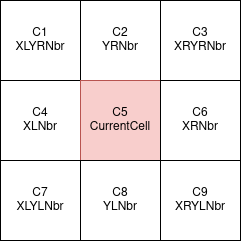

# Depth-averaged Avalanche Equations #
## Specification for SWPouliquenEqn2DViscous given by NGI ##

$$
\frac{\partial}{\partial t} \begin{pmatrix}
                h\\hu\\hv
               \end{pmatrix}
               + \frac{\partial}{\partial x}
               \begin{pmatrix}
                hu\\hu^2 + \frac{1}{2} \cdot g\cos(\zeta)h^2\\huv
               \end{pmatrix}
               +  \frac{\partial}{\partial y}
               \begin{pmatrix}
                hv\\huv\\hv^2 + \frac{1}{2} \cdot g\cos(\zeta)h^2
               \end{pmatrix}
               +D(x) + D(y) = 
               \begin{pmatrix}
                0\\hg\sin(\zeta)-\mu\frac{u}{\sqrt{u^2+v^2}}hg\cos(\zeta)\\-\mu\frac{v}{\sqrt{u^2+v^2}}hg\cos(\zeta)
               \end{pmatrix},
$$
where
$$
D(x)=\begin{pmatrix}
                0\\-\nu\sqrt{h}(1.5\cdot\frac{\partial h}{\partial x}\frac{\partial u}{\partial x} + h\frac{\partial^2 u}{\partial x^2})\\-0.5\cdot\nu\sqrt{h}(1.5\cdot\frac{\partial h}{\partial x}(\frac{\partial u}{\partial y}+\frac{\partial v}{\partial x})+h(\frac{\partial u}{\partial y \partial x}+\frac{\partial^2 v}{\partial x^2}))
               \end{pmatrix},
               
$$
$$
D(y)=\begin{pmatrix}
                0\\-0.5\cdot\nu\sqrt{h}(1.5\cdot\frac{\partial h}{\partial y}(\frac{\partial u}{\partial y}+\frac{\partial v}{\partial x})+h(\frac{\partial^2 u}{\partial y^2}+\frac{\partial v}{\partial x \partial y}))\\-\nu\sqrt{h}(1.5\cdot\frac{\partial h}{\partial y}\frac{\partial v}{\partial y} + h\frac{\partial^2 v}{\partial y^2})
               \end{pmatrix}.        
$$

At the moment the source terms have been commented out in the code and only the ncp term is used. The ncp term requires calculation of partial derivatives of $h$, $u$ and $v$. These derivatives are calculated by finite difference schemes using a 9 point stencil(ref fig).

  

We use the notation: $u(C2)$ = value of $u$ in cell $C2$.
The derivatives in cell 5 are calulated as follows:

$$\frac{\partial u}{\partial x} = \frac{u(C5)-u(C4)}{\Delta x}$$
$$\frac{\partial u}{\partial y} = \frac{u(C5)-u(C8)}{\Delta y}$$
$$\frac{\partial^2 u}{\partial x^2} = \frac{u(C6)-2u(C5)+u(C4)}{(\Delta x)^{2}}$$
$$\frac{\partial^2 u}{\partial y^2} = \frac{u(C2)-2u(C5)+u(C8)}{(\Delta y)^{2}}$$
$$\frac{\partial^2 u}{\partial x \partial y} = \frac{u(C3)-u(C1)-u(C9)+u(C7)}{4\cdot \Delta x\cdot \Delta y}$$
Similarly derivatives of $h$ and $v$ are calculated.

The derivative calculation is done [here](https://gitlab.lrz.de/hpcsoftware/Peano/-/blob/swe-avalanche/applications/exahype2/saint-venant/SaintVenantKernels.h?ref_type=heads#L271) (calculation of numerator) and [here](https://gitlab.lrz.de/hpcsoftware/Peano/-/blob/swe-avalanche/applications/exahype2/saint-venant/avalanche.py?ref_type=heads#L101). Additionally volume size is multiplied [here](https://gitlab.lrz.de/hpcsoftware/Peano/-/blob/swe-avalanche/applications/exahype2/saint-venant/avalanche.py?ref_type=heads#L120) to account for division by `patchSize(normal)` in the loopbody [here](https://gitlab.lrz.de/hpcsoftware/Peano/-/blob/swe-avalanche/src/exahype2/fv/rusanov/LoopBody.cpph?ref_type=heads#L981)

