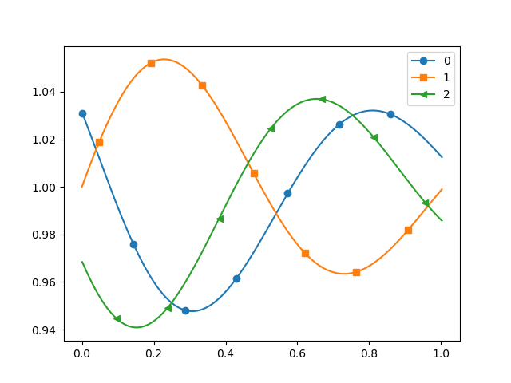

# CCZ4 Gauge wave test

The CCZ4 Gauge wave test is a relatively simple setup, where we employ a 
regular mesh over the unit square. The computational domain is centered 
around the origina of the coordinate system. It is supplemented with periodic boundary
conditions all all sides. In theory, the wave we simulate should be a 
standing wave leaving the domain on the right and re-entering it on the left.
If the wave shape or its amplitude change over time, this is due to numerical
effects. The setup is thus convenient to assess properties of different
numerical schemes.  

## Build executables

It is reasonable to start the Python script with the --help option once to 
see what variants are on the table. For most of my experiments, I stick to 
all the default settings, but I manually enable the tracers, as these allow
me to track the simulation behaviour in time elegantly (see postprocessing
discussion below):

     python3 convergence-study.py -s fv -tracer
     python3 convergence-study.py -s dg1-rk1 -tracer
     python3 convergence-study.py -s dg2-rk2 -tracer
     python3 convergence-study.py -s dg3-rk3 -tracer
     python3 convergence-study.py -s dg4-rk4 -tracer

## Clean up old and temporary files

The following statements remove all the glue code and autogenerated C++ files.
There is no risk in deleting them - if you rerun the Python script, they will 
all be reinstantiated.

     rm *.o
     rm Readme-*.md
     rm Makefile
     rm Abstract*
     rm -rf celldata facedata globaldata observers tasks vertexdata

To get rid of the output files, type in

     rm *patch-file *vtu *.pvd

## Postprocess/visualise the results

The setup as defined in the Python script writes 20 snapshots of the solution
as Peano patch files. You can convert them into vtk for example and visualise
them via Paraview. 

     pvpython ../../../../python/peano4/visualisation/render.py --filter-fine-grid solution-CCZ4DG2RK2.peano-patch-file

Besides these snapshots, the code also injects three tracers
at the positions (-0.4251,0,0), (0,0,0) and (0.4251,0,0).
As the tracers do not move, they should yield perfect oscillations (if there 
were no numerical artifacts). As the wave travels from left to right, the 
symmetric arrangement of the probes (tracers) does not yield symmetric or 
flipped graphs, but all three points should display the same curve subject
to a shift in time.

The code writes the sample results into a csv file upon completion. You can use
Peano's pre-manufactured postprocessing scripts to get a first impression of the 
solution's behaviour. The call to the script is similar to 

     python3 Peano/python/peano4/toolbox/particles/postprocessing/convert.py -d 3 -v 13 -t seismogram Tracer-fv-0.3-rank-0-snapshot-0.csv

with appropriate pathes and filenames set.

You should obtain pdfs and pngs that resemble the following graphs for Finite
Volumes:

The above graphs are produced for the experiment's default settings i.e. a mesh size
of 0.3. They study piecewise constant interpolation onto the tracer (left) vs. piecewise
linear. Despite the relatively coarse resolution, the graphs are basically identical, 
i.e. the default resolution is already sufficient to study the long-term behaviour
of the solution.
Though these graphs simulate only a very brief total time (up to end time 1.0), we 
already see a strong damping of the amplitudes.
This is a characteristic property of first-order Finite Volume schemes.

