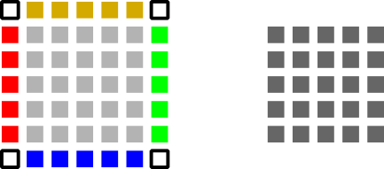

# Selection of benchmarks for the Euler compute kernels

This directory hosts a set of benchmarks which assess the sole performance of 
the individual kernels on the CPU and GPUs. While this might be of limited 
relevance for large-scale runs, where scalability, IO overheads and other
factors play a dominant role, it tells us what the core compute routines could,
in theory, deliver.

## Build code baseline (required libraries)

Clone the repository via

      git clone -b gpus https://gitlab.lrz.de/hpcsoftware/Peano.git
      
After that, configure the build via

### SYCL setup      

OneAPI on Cosma:

     module load oneAPI/2022.3.0
     module load gnu_comp/11.1.0
     libtoolize; aclocal; autoconf; autoheader; cp src/config.h.in .; automake --add-missing
     ./configure CXX=dpcpp CC=dpcpp CXXFLAGS="-g3 -std=c++20 -Wno-unknown-attributes" LDFLAGS="-ltbb" --enable-exahype --enable-loadbalancing --enable-particles --enable-blockstructured --with-gpu=sycl
     make -j
      

Codeplay on Cosma:

    module load sycl/2022.11-codeplay-cuda    
    module load gnu_comp/11.1.0
    ./configure CXX=clang++ CC=clang++ CXXFLAGS="-g3 -std=c++20 -Wno-unknown-attributes -fsycl -fsycl-targets=nvptx64-nvidia-cuda -DnoComplexNumbers" LDFLAGS="-fsycl -fsycl-targets=nvptx64-nvidia-cuda" --enable-exahype --enable-loadbalancing --enable-blockstructured --with-gpu=sycl    
    #./configure CXX=clang++ CC=clang++ CXXFLAGS="-g3 -std=c++20 -Wno-unknown-attributes -fsycl -fsycl-targets=nvptx64-nvidia-cuda -Xsycl-target-backend -offload-arch=sm_80" LDFLAGS="-fsycl -fsycl-targets=nvptx64-nvidia-cuda -Xsycl-target-backend -offload-arch=sm_80" --enable-exahype --enable-loadbalancing --enable-blockstructured --with-gpu=sycl    
      

Codeplay on Isambard:

    module use /lustre/projects/bristol/modules-phase3/modulefiles
    module load llvm/sycl/2022_11_21
    ./configure CXX=clang++ CC=clang++ CXXFLAGS="-g3 -std=c++20 -Wno-unknown-attributes -fsycl -fsycl-targets=nvptx64-nvidia-cuda" LDFLAGS="-fsycl -fsycl-targets=nvptx64-nvidia-cuda" --enable-exahype --enable-loadbalancing --enable-blockstructured --with-gpu=sycl    

The libtoolize commands (second line) are required only once. Also, it should
be fine only to run configure once, even if you change some core routines
later. 

    
### OpenMP setup      

     module load oneAPI/2022.3.0
     module load gnu_comp/11.1.0
     module load cuda/11.2
     ./configure CXX=icpx CC=icx CXXFLAGS="-g3 -std=c++20 -Wno-unknown-attributes -fiopenmp  -fopenmp-targets=spir64" FCFLAGS="-fiopenmp  -fopenmp-targets=spir64" --enable-exahype --enable-loadbalancing --enable-particles --with-multithreading=omp --enable-blockstructured --with-gpu=omp
     make -j
     

      

## Build benchmarks

There are different benchmarks for the different solver types (currently finite
volumes and discontinuous Galerking) and you have to build different executables
for different patch sizes, orders or dimensions. Below is a set of benchmarks 
that I tend to build from time to time.

### Finite Volumes

I typically create a bunch of benchmarks around the Finite Volume solvers:

    export PYTHONPATH=../../../../python

    python3 fv-rusanov-kernel-benchmarks.py --dim 2 --patch-size 4 
    python3 fv-rusanov-kernel-benchmarks.py --dim 2 --patch-size 6 
    python3 fv-rusanov-kernel-benchmarks.py --dim 2 --patch-size 8 

    python3 fv-rusanov-kernel-benchmarks.py --dim 3 --patch-size 4 
    python3 fv-rusanov-kernel-benchmarks.py --dim 3 --patch-size 6 
    python3 fv-rusanov-kernel-benchmarks.py --dim 3 --patch-size 8 

## Clean up

You can throw away all of the glue code after a successful build. This is 
triggered by
    
    
     rm Abstract* Readme* Makefile Constants.h
     rm -rf celldata facedata observers repositories tasks
     rm *.o

## Run experiments

All the benchmarks run out of the box without any user interaction once built.
All of them produce outputs in a similar way, so it is easier to interpret the
outcomes. For most runs, you don't have to specify anything. However, you might
want to call

      ./my-benchmark --help

It enlists the standard ExaHyPE command line arguments that every code has. Most
of them play no role here, but the thread count and the gpu filters do, i.e. you
can ensure that we use a certain thread count only, and you can pick the GPUs 
that the benchmark should assess. 

Note the slightly different semantics of the GPU setting for SYCL and OpenMP: 
For SYCL, you explicitly have to specify which GPUs you want to use. You can 
pass all as argument, but you have to pass something. Otherwise, ExaHyPE will
only use the host. OpenMP in contrast uses all the devices that are available
by default.

### Finite Volumes

I typically run the Finite Volume solvers with

    ./kernel-benchmark-fv-2d-patch-size-4 --threads 1 -gpus all
    ./kernel-benchmark-fv-2d-patch-size-4 --threads 2 -gpus all
    ./kernel-benchmark-fv-2d-patch-size-4 --threads 4 -gpus all
    ./kernel-benchmark-fv-2d-patch-size-4 --threads 8 -gpus all

to obtain a first insight into how the throughput changes as more and more 
threads hit the GPUs with kernel invocations.

## Visualisation of results (runtime behaviour)

If you want to use the pre-manufactured visualisation scripts, you have to pipe
the program output into a file. After that, invoke

    python3 create-bar-plot.py outputfile

## Science case

As sketched above, this code studies the kernel that takes one cell or 
patch (aka a small regular grid) and advances it in time by one time step.
In ExaHyPE 2, this is a fundamental building block behind more complex 
solvers. Also, we use a very simple PDE (Euler) here, whereas a real 
simulation uses more complex PDEs.

Our benchmark suite yields data this fundamental algorithmic building 
block, and it sets up scenarios where many of these patches are updated
in parallel (on the host) and/or many sets of these update kernels are
offloaded to the accelerator at the same time - potentially by multiple
threads.

Depending on the chosen backend (OpenMP or C++ or SYCL), we offer various
implementations of the core computational kernels, and the different variants
typically can be configured differently furthermore. Details on 
how things are realised can be found in the respective header files 
(Rusanov.h) in the subdirectories of the kernels that you use, i.e. within
exahype2/solvers/fv/rusanov/... The discussion below however gives a 
high-level (algorithmic) overview what the individual kernels do compute
step by step: 

### Finite Volumes

The Finite Volumes solvers works with small regular grids (patches). A compute
kernel is given a patch augmented by a halo layer of size one. In the real 
simulation, the halo layer is befilled with copies of data from neighbouring
cells. With the halo, we can thus advance a patch in time without any 
synchronisation with a neighbour. 

So we are given the patch (grey) plus the halo cells (red, blue, yellow, green).
We also pass in the white cells, though they have not meaning. They are just 
there to make all arrays simple. The patch consequently consists of (p+2)x(p+2)
volumes (in 2d). Each volume holds five unknowns for Euler, i.e. the whole 
thing is encoded as SoA. The output of a patch kernel is the updated inner patch.
As we work with GPU kernels which require high workload, we do not only update
one patch in one go, but the kernel actually accepts a set of patches, i.e. 
updates multiple patches in one rush.

The discussion of the actual Finite Volume update scheme can be found in the 
source code on the respective documentation page (or really any introductory
book to the field). For the present benchmarks, it is important to understand
what steps are produced. For each and every patch

- we copy the old solution over into the output. That's the starting point and
  if we had only this step, nothing would move yet. Next, we have to add the 
  actual moving fluid on top. For this,
- we compute per finite volume, i.e. element within the patch, a couple of 
  quantities: fluxes, maximum eigenvalues, sources.
- These results are then added via a linear combination to each and every
  volume (array element).
  
Eventually, the whole code is a sequence of nested loops. The individual 
calculations are realised as template (and therefore aggressively inlined 
without any function call overhead) and dump their results into a temporary 
array. If the final linear combination requires a function @f$ flux_x @f$,
the kernels first create a huge array (scratchpad) for the results. They 
then loop over all cells and compute @f$ flux_x @f$ as well as all other
outcomes. These are then finally combined into the kernel outcome, and we
can free the temporary data structure. Access to the temporary data structure
can be via AoS or SoA (it might make sense to reorder the temporary data - 
we don't know yet) and as a kernel processes N patches in one go, it also 
makes this initial scratchpad so big that it can hold all the temporary data
for the N patches. 

The header files of the kernels (Rusanov.h) contain quite some documentation
how individiual kernels are realised. I recommend always to start reading 
timeStepWithRusanov_piecewise_heap_static_calls() first, as it is the 1:1 
translation of the numerical scheme. Please note that our numerical kernels
can handle quite "sophisticated" PDEs with non-conservative products and 
source terms. They are not used in the present benchmarks. In the kernels,
there are booleans to switch the terms on and off. As they are templates,
the compiler can eliminate dead code that's never used.

All the kernels are sequential in the sense that they do not use multiple
cores on the host. Several of these kernels however might run on multiple
threads in parallel and hence interfer with each other performance-wisely.
When we offload a bunch of patches to a GPU, the underlying kernel obviously
has to exploit the GPU's concurrency. Again, we can simulate what happens
if multiple threads try to fire kernels to the GPU at the same time.

### Troubleshooting (with SYCL and the other back-ends)

Before you dive into details, only run with 

     --threads 1 -gpus 0
     
i.e. with one thread and one GPU. If one thread and one GPU do not work, 
it makes no sense to continue if you know that this simple setup fails
already.

The code is reasonably well-structured with only few places where the 
compute kernels are actually triggered. All the wrapper code around the
kernels is in the main, and it is so simple that it should be easy to 
understand and definitely run with whatever system you employ.

If you find your code crashing, I recommend that you comment out the 
kernel calls. The SYCL calls for example can be found in the routine

     void submitSYCLKernels(int patches, int device, int thread) {

and I suggest that you comment all the testStatelessVariantOnDevice()
calls in there out if you encounter issues. Check if the code works
without the kernels, and then comment them in again one by one.

