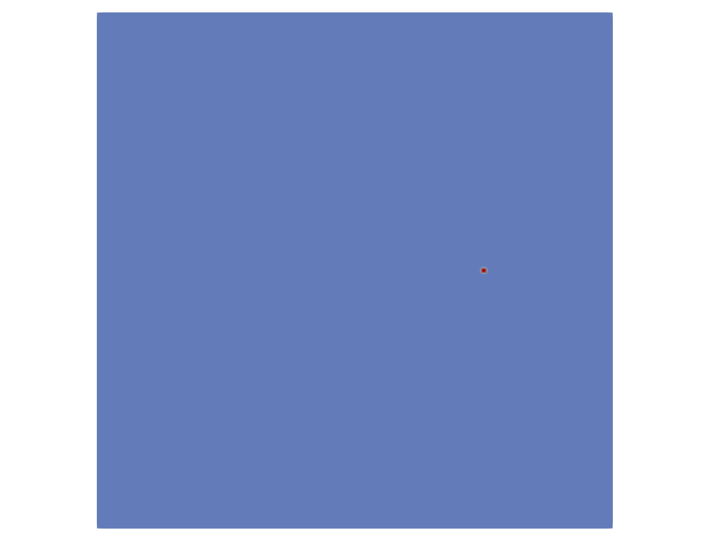
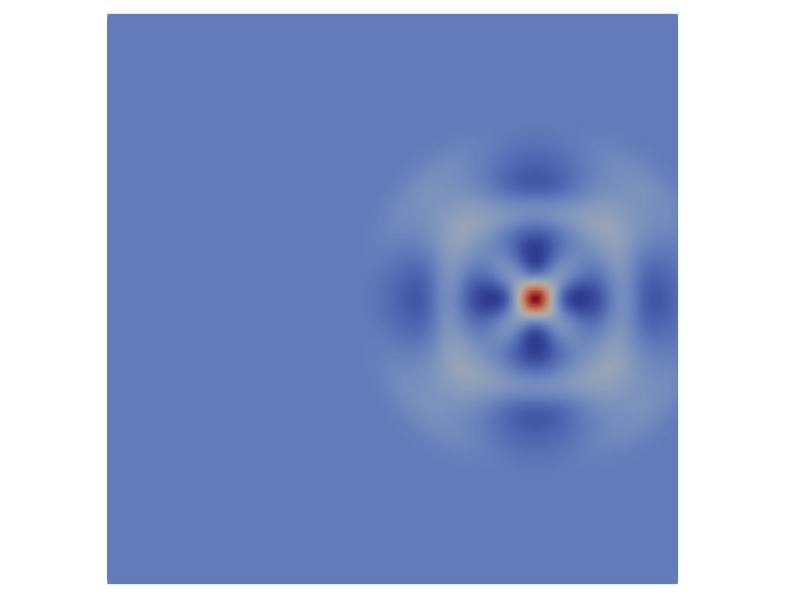

# Tutorial: The Elastic Wave Equation

## Define and Build the Project
Assuming we have built the ExaHyPE 2 engine and the core libraries successfully, we can build the Elastic Wave project:

    python3 elastic-wave.py

Assuming this was successful, you should see several files have appeared in your working directory.
We will ignore most of these for now but know that these contain the implementation of the ExaHyPE 2 project.
One file, in particular, is of interest to us now: the file simply named elastic-wave-* is the executable for our implementation.
We will therefore run this executable file by using the following command:

    ./elastic-wave-<dimensions>d

The solution folder contains the solution to our problem,
which we will take a look at as soon as we have an understanding of how our problem is defined.

To understand what it is that we have executed, let us take a look at the file which defined this project:

    elastic-wave.py

As this is a Python script, it should surprise no one that we start with the following:

    import peano4
    import exahype2

These merely import the necessary packages from Peano 4 and ExaHyPE 2
which will let us define and build our project. For more details about
the implementation, consider the comments in the Python script.

## Two-dimensional Elastic Wave Equation
The elastic wave equation describes the propagation of waves in elastic solids.
They are commonly derived from the conservation of momentum and the constitutive relation,
defined by Hookes's law. With the assumption that the relation between stress and strain can
be linearised for relatively small deformations this results in the linear elastic wave equation.

A material is described by its density $`\rho`$, shear modulus $`\mu`$ and the Lamé constant $`\lambda`$.

This tutorial implements the elastic wave equation in its first-order formulation:

$$
    \partial_t \begin{pmatrix}
                u\\v\\ \sigma_{xx} \\ \sigma_{yy} \\ \sigma_{xy}
               \end{pmatrix}
               + \nabla \cdot F
               \begin{pmatrix}
                u\\v\\ \sigma_{xx} \\ \sigma_{yy} \\ \sigma_{xy}
               \end{pmatrix} = 0,
$$

With $`F=\left(F_1,F_2\right)`$ being a tensor describing the linear flux:

$$
    F_1 =
        \begin{pmatrix}
        0 & 0 & 1/\rho &  0 & 0 \\
        0 & 0 &      0 &  0 & 1/\rho \\
        \left(\lambda + 2\mu \right) & 0 & 0 & 0 & 0  \\
        \lambda&0&0&0&0 \\
        0&\mu&0&0&0
        \end{pmatrix},
$$

and

$$
    F_2 =
        \begin{pmatrix}
        0 & 0 & 0 &  0 & 1/\rho \\
        0 & 0 &   0 &  1/\rho &  0\\
        0 & \lambda & 0 & 0 & 0  \\
        0 & \left(\lambda + 2\mu \right) & 0 & 0 & 0 \\
        \mu & 0 & 0 & 0 & 0
        \end{pmatrix}.
$$

In elastic materials, two types of waves can propagate through the domain: p-waves and s-waves.
Their speeds are

$$
    c_s=\sqrt{\frac{\mu}{\rho}},
$$

and

$$
    c_p=\sqrt{\frac{\lambda + 2 \mu}{\rho}}.
$$

These speeds also define the eigenvalues of the flux:

$$
    \left( -c_p, -c_s , 0 , c_s , c_p \right)
$$

t=0.0             |  t=1.0
:-------------------------:|:-------------------------:
  |  

-------------------------*The computed stress of the 2D elastic wave equation at times t=0.0 and t=1.0*-------------------------
