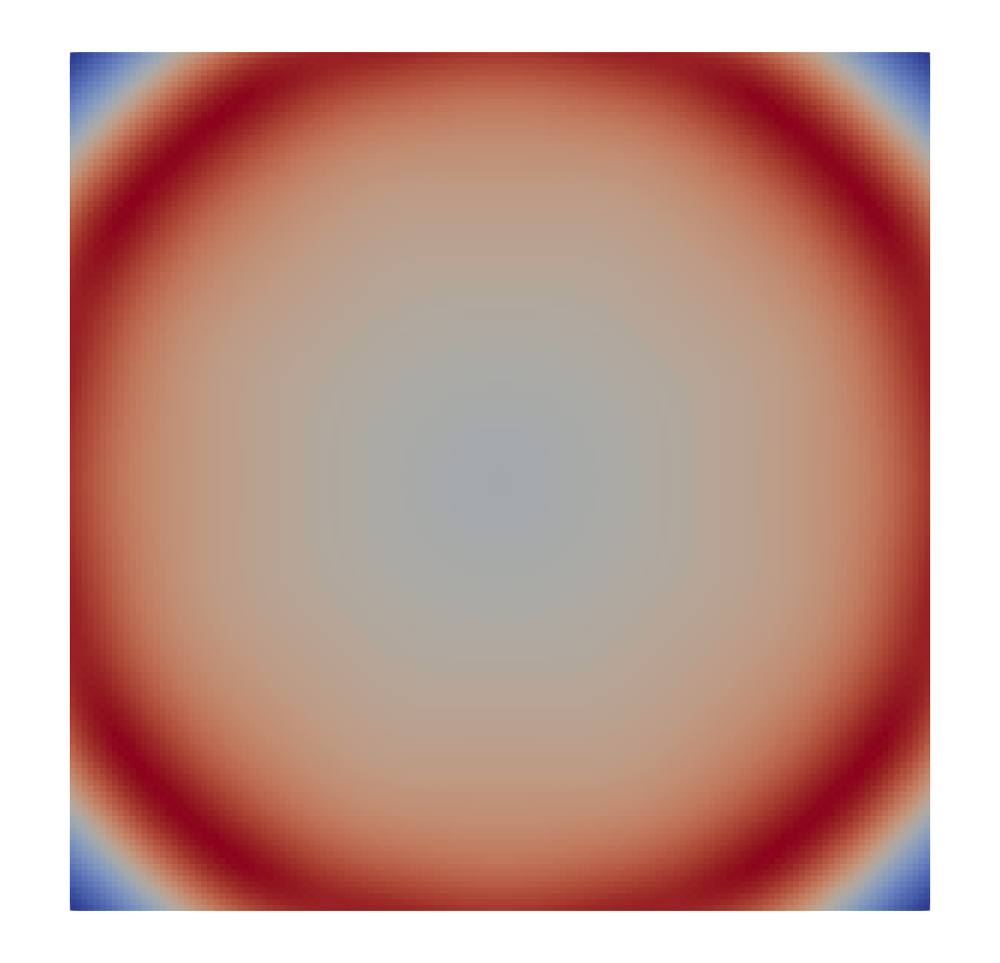
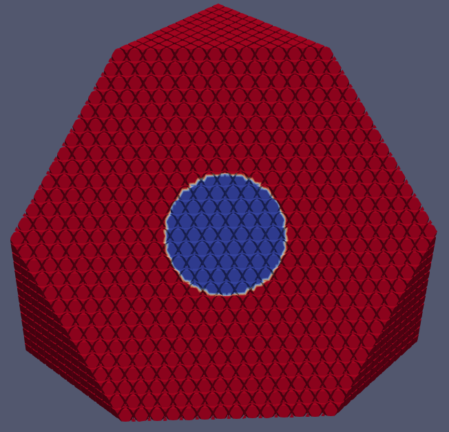
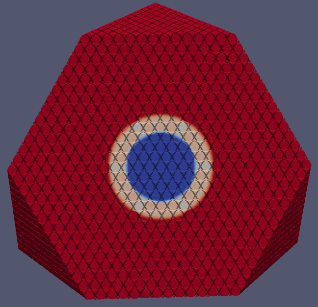

# Tutorial: The Euler Equations

## Define and Build the Project
Assuming we have built the ExaHyPE 2 engine and the core libraries successfully, we can build the Euler project:

    python3 euler.py

Assuming this was successful, you should see several files have appeared in your working directory.
We will ignore most of these for now but know that these contain the implementation of the ExaHyPE 2 project.
One file, in particular, is of interest to us now: the file simply named euler-* is the executable for our implementation.
We will therefore run this executable file by using the following command:

    ./euler-<dimensions>d

The solution folder contains the solution to our problem,
which we will take a look at as soon as we have an understanding of how our problem is defined.

To understand what it is that we have executed, let us take a look at the file which defined this project:

    euler.py

As this is a Python script, it should surprise no one that we start with the following:

    import peano4
    import exahype2

These merely import the necessary packages from Peano 4 and ExaHyPE 2
which will let us define and build our project. For more details about
the implementation, consider the comments in the Python script.

## Two-dimensional Euler Equations
The Euler equations describe the movement of a fluid if there is neither loss of
energy due to frictional forces nor heat conduction in the system.
In the finite volume form and given no external forces, the two-dimensional form
of the Euler equations appears as follows:

$$
    \frac{\partial}{\partial t}\left(
    \begin{array}{lr} \rho \\
                      \rho u_1 \\
                      \rho u_2 \\
                      E_t
                      \end{array} \right) +
    \nabla \begin{pmatrix}
                      \rho u_1          & \rho u_2\\
                      \rho u_1^2 + p    & \rho u_1 u_2 \\
                      \rho u_2 u_1      & \rho u_2^2 + p \\
                      (E_t + p) u_1     & (E_t + p) u_2
    \end{pmatrix}  = \vec{0},
$$

where $`\rho`$ is the density, $`u`$ is the velocity, $`E_t`$ is the energy and $`p`$ is the pressure.

This can also be rewritten as

$$
  \frac{\partial}{\partial t} \begin{pmatrix}
  \rho\\j\\\ E
  \end{pmatrix}
  +
  \nabla\cdot\begin{pmatrix}
  {j}\\
  \frac{1}{\rho}j\otimes j + p I \\
  \frac{1}{\rho}j\,(E + p)
  \end{pmatrix}
  = \vec{0}.
$$

To implement this equation, the following things are needed: the initial condition,
the boundary conditions, the maximal eigenvalue, the flux, and (optionally) the
refinement criterion (which we don't use in the tutorial).

### Initial Conditions
We start with the initial conditions: here we define a starting configuration with a uniform
density of 1.0, a uniform starting momentum of 0.0 in both x- and y-directions and a starting energy
that is 1.0 inside of a circle of radius 0.2 around the center of the domain and 1.01 outside of it.
Note that we use momentums and not velocities as our variables of choice,
this will affect the formulation of some of the equations later.

### Boundary Conditions
Then we can define our boundary conditions.
You can choose any boundary conditions you prefer but we have chosen to use the
homogeneous Neumann boundary conditions.

### Eigenvalues
Next, we can define the eigenvalues of our system. The eigenvalues of the 2-dimensional Euler equations are:

$$
    \left(
    \begin{array}{lr} \lambda_1 \\
                      \lambda_2 \\
                      \lambda_3
                      \end{array} \right) =
    \left(
    \begin{array}{lr} u - c \\
                      u \\
                      u + c
                      \end{array} \right)
$$

where $`c`$ is the wave propagation speed.
For dry air, which can be approximated as an ideal gas, c depends on the pressure as follows:

$$
    \left(
    \begin{array}{lr} \gamma \\
                      p \\
                      c
                      \end{array} \right) =
    \left(
    \begin{array}{lr}   1.4 \\
                        (\gamma - 1) ( E_t - \frac{1}{2 \rho} (\rho u)^2 ) \\
                        \sqrt[]{\frac{\gamma  p}{\rho}}
                        \end{array} \right)
$$

t=0.0             |  t=1.0
:-------------------------:|:-------------------------:
  |  

-------------------------*The computed energy of the 2D Euler equations at times t=0.0 and t=1.0*-------------------------

## Three-dimensional Euler Equations
Finally, we can implement the Euler equations in three dimensions.

The three-dimensional Euler equations are very similar to the two-dimensional equations:

$$
    \frac{\partial}{\partial t}\left(
        \begin{array}{lr}
                    \rho \\
                    \rho u_1 \\
                    \rho u_2 \\
                    \rho u_3 \\
                    E_t
        \end{array} \right) +
    \nabla
        \begin{pmatrix}
            \rho u_1          & \rho u_2            & \rho u_3\\
            \rho u_1^2 + p    & \rho u_1 u_2        & \rho u_1 u_3 \\
            \rho u_2 u_1      & \rho u_2^2 + p      & \rho u_2 u_3 \\
            \rho u_3 u_1      & \rho u_3 u_2 + p    & \rho u_3^2 + p \\
            (E_t + p) u_1     & (E_t + p) u_2       & (E_t + p) u_3
        \end{pmatrix}  = \vec{0}
$$

These have the same eigenvalues as the 2D solution:

$$
    \lambda = \left( \begin{array}{lr}
                     u-c \\
                     u \\
                     u+c \\
        \end{array} \right)
$$

And you can use the same approximation for the pressure and wave velocity:

$$
    \left( \begin{array}{lr}
            \gamma \\
            p \\
            c \end{array} \right) =
    \left( \begin{array}{lr}
                     1.4 \\
                     (\gamma - 1) * ( E_t - \frac{\rho \|u\|}{2} ) \\
                    \sqrt[]{\frac{\gamma  p}{\rho}} \\
        \end{array} \right)
$$

t=0.0             |  t=1.0
:-------------------------:|:-------------------------:
  |  

-------------------------*The computed energy of the 3D Euler equations at times t=0.0s and t=1.0s.*-------------------------
